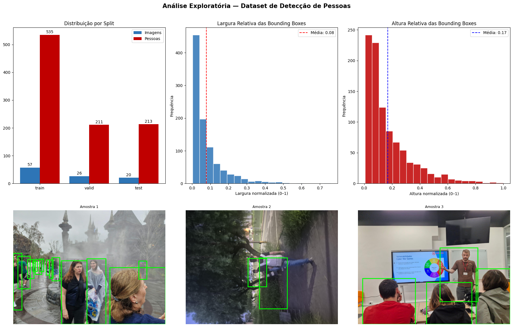
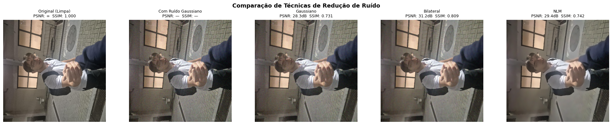
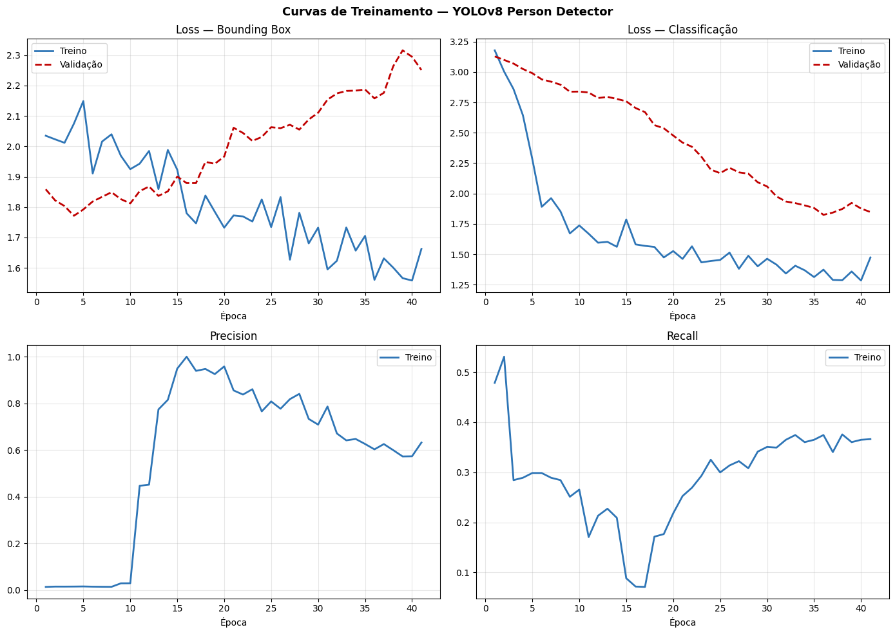

# Detecção de pessoas com YOLOv8

[](https://colab.research.google.com/github/ThiagoPGPEsteves/deteccao-pessoas-yolov8/blob/main/deteccao_pessoas_yolov8.ipynb)

Detector de pessoas treinado com **transfer learning** a partir do YOLOv8n (pesos COCO), usando um dataset próprio anotado no Roboflow. O notebook cobre o ciclo completo: download dos dados, análise exploratória, comparação de filtros de pré-processamento, treino, avaliação no conjunto de teste e inferência em imagens novas.

## Resultados

| Conjunto | Precisão | Recall | mAP@50 | mAP@50-95 |
|---|---|---|---|---|
| Validação (melhor época, 31) | 0,69 | 0,36 | 0,41 | 0,17 |
| Teste | 0,89 | 0,12 | 0,11 | 0,08 |

**Leitura honesta dos números:** o modelo acerta quando detecta (precisão alta), mas deixa de detectar a maioria das pessoas no teste (recall baixo). A principal causa é o tamanho do dataset (57 imagens de treino). A diferença entre validação e teste pode indicar que os dois conjuntos têm cenas diferentes, e mostra que o modelo ainda não generaliza bem.

Comparação de filtros de ruído (ruído gaussiano artificial, σ = 15):

| Filtro | PSNR (dB) | SSIM |
|---|---|---|
| Gaussiano | 28,30 | 0,731 |
| **Bilateral** | **31,16** | **0,810** |
| Non-Local Means | 29,43 | 0,742 |

O filtro bilateral teve o melhor resultado e foi o escolhido para o pré-processamento.

## Dataset

| Split | Imagens | Pessoas anotadas |
|---|---|---|
| Treino | 57 | 535 |
| Validação | 26 | 211 |
| Teste | 20 | 213 |

Anotado no Roboflow e exportado no formato YOLOv8. O dataset não fica neste repositório; o notebook baixa a versão 2 pela API do Roboflow.

## Gráficos







## Método

- **Modelo:** YOLOv8n pré-treinado no COCO, ajustado (fine-tuning) para a classe pessoa.
- **Treino:** até 50 épocas, imagens 640×640, batch 16, SGD (lr 0,01), data augmentation (mosaic, flips, cor) e early stopping com paciência 10. O treino parou na época 41 e a melhor foi a 31.
- **Avaliação:** conjunto de teste separado, com limiar de confiança 0,40 e IoU 0,50.

## Como executar

1. Clique em **Open in Colab** acima.
2. Crie uma chave de API no Roboflow e salve-a nos **Secrets** do Colab com o nome `ROBOFLOW_API_KEY`.
3. Ative a GPU (Ambiente de execução → Alterar o tipo de ambiente) e execute as células em ordem. Na CPU, o treino levou cerca de 45 minutos.

Localmente:

```bash
pip install -r requirements.txt
jupyter notebook deteccao_pessoas_yolov8.ipynb
```

## Estrutura

```
.
├── deteccao_pessoas_yolov8.ipynb   # notebook completo, com as saídas salvas
├── eda_dataset.png                 # gráficos usados neste README
├── comparacao_denoising.png
├── curvas_treinamento.png
├── requirements.txt
└── README.md
```

## Limitações e próximos passos

- Ampliar o dataset para 300 ou mais imagens, com cenas mais variadas.
- Comparar YOLOv8n com YOLOv8s.
- Ajustar o limiar de confiança olhando a curva precisão-recall, já que o recall é o ponto fraco.
- Publicar o modelo treinado no Hugging Face.
